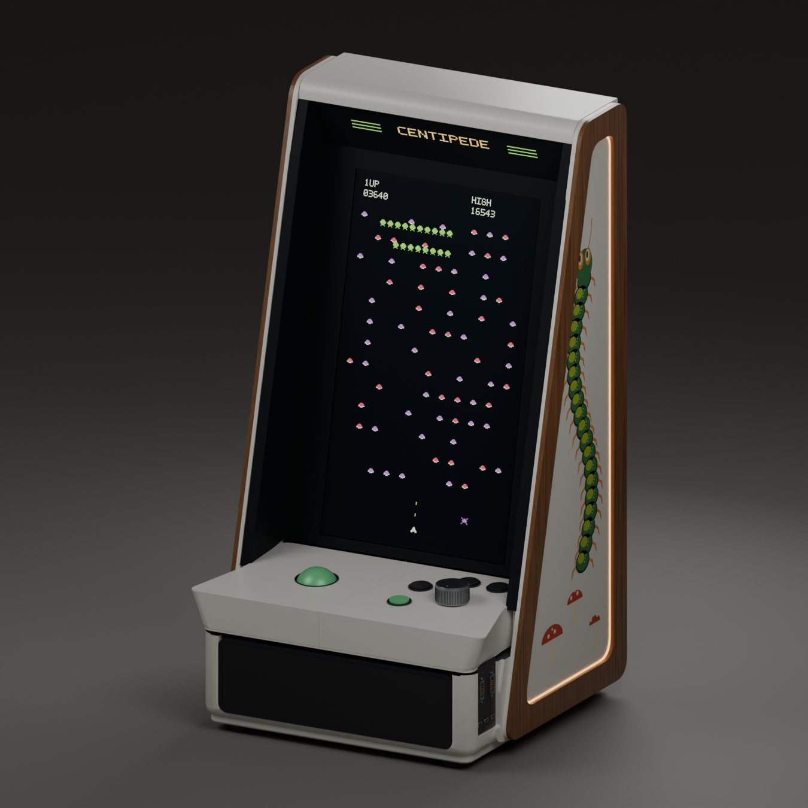
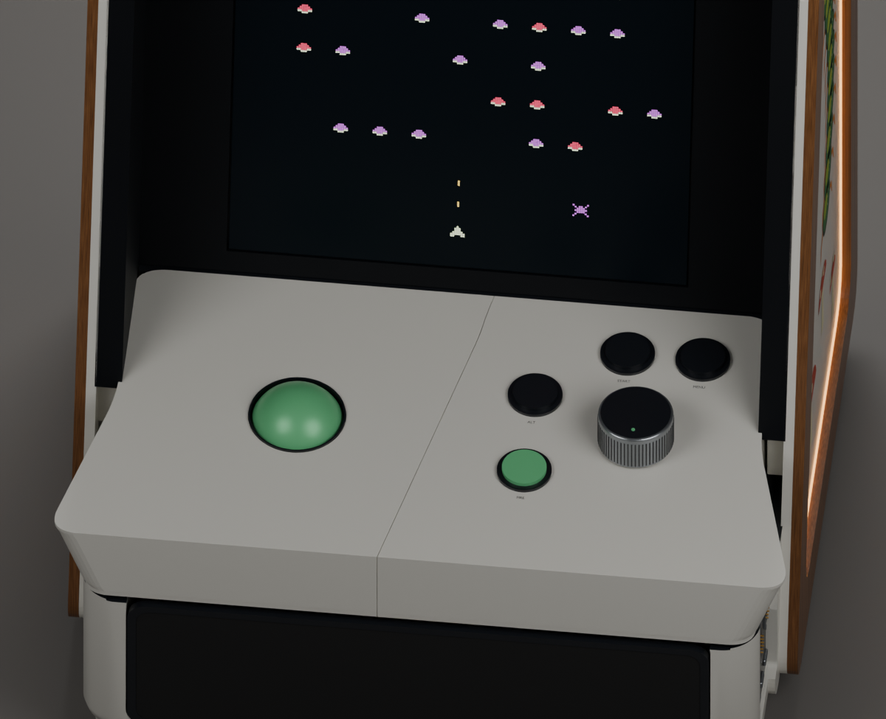
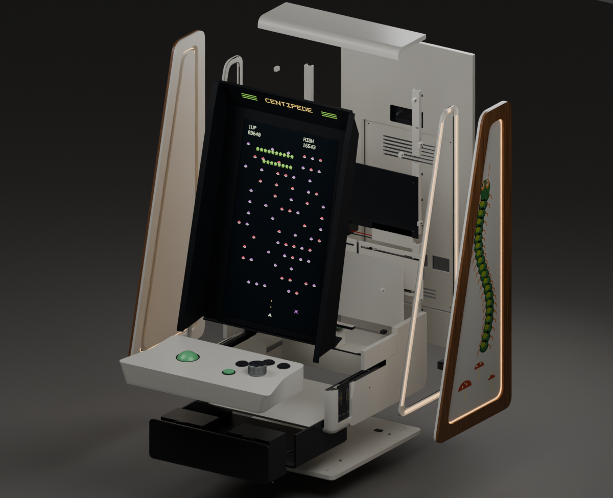

# Cabinet 49 · assembly and print preparation

13 November 2026 · Cabinet38 structure with the fitted controller45 assembly

[Assembled Blender](cabinet-49-assembled.blend) · [Disassembled Blender](cabinet-49-disassembled.blend) · [Main build guide](../main-cabinet-guide/build-guide.html)

## Proceed now, in stages

The purchased magnetic connector does not block cabinet development. Use the existing USB leads and removable blank surrounds while its exact body, plug and stroke are unconfirmed. Develop the base, internal structural frame, service access, cable channels and printer-sized joints now. Keep hardware-specific mounts replaceable.

**This is a review assembly and fabrication plan, not a cabinet print release.** There is no full-cabinet Bambu file in this folder. The current shell still needs load-bearing joints, a monitor cradle, controller retention and tested print segmentation. Splitting its visual meshes into bed-sized chunks alone would not produce a usable cabinet.

## What changed

- Cabinet49 incorporates the actual controller45 Centipede parts, including the diagonal magnetic seam, four-wall independent halves, recessed bottom screw heads, inside-top Easyget mount and hidden overlay magnets.
- Controller mesh coordinates were retained exactly. The installed translation remains X0, Y−17, Z+4.5 mm. No controller reprint is required by this assembly update.
- Cabinet38's structure, outer contours, screen, trim, receiver and drawer geometry are retained. Geometry signatures check that the non-controller objects did not change.
- Trackball reference: 87.127473 mm square mounting pitch, Ø12 mm posts, 10.83 mm support height and Ø57.10 mm opening. Easyget: 79.6 × 29.6 mm, M3 mounting. These supersede the older values in cabinet38.

## First cabinet fit print

Prepare a short **receiver and lower-front clearance jig**, referenced to an actual completed controller45 pair. It should establish the final seated height and front stop, check both independent halves as one cartridge, and expose the drawer/feet clearance so it can be inspected from the side.

Check bare bottoms and optional Ø20 mm feet with Ø18 × 1.27 mm pads. Include the full insertion path of the feet, recessed screw heads and seam keys. The controller is the fitted master: revise the cabinet receiver to suit it. Do not move the controls, change the outer profile or reprint the fitted halves for this step.

The older guide quotes 1.83 mm foot-to-drawer clearance from controller30/37. That remains a useful vertical reference, but it is not a completed clearance check for the revision43–45 bottom and relocated closure posts. The old underside runners are optional references; confirm a real fastening method before including them in the fit kit. Add a positive release/retention feature that takes playing loads independently of electrical contacts.

## A1 print preparation order

These are planned print groups, not released plates. Final counts depend on the structural joints. Design within a working envelope of approximately 240 × 240 mm to leave room for bed margins and adhesion features on the A1's 256 mm bed.

| Order / proposed plate label | Purpose | Release condition |
| --- | --- | --- |
| 01 FIT – receiver and cartridge clearance | Short inspection fixture for the assembled controller, bare bottom and optional feet | New receiver dimensions and an accessible fastening method |
| 02 FIT – base joint and frame socket | Small bolted joint sample before the large base | Select joint layout, verify insert access and fit |
| 03 FIT – side-panel disc magnet seat | Convert legacy bar-magnet holders to Ø6 × 3 mm discs | Fit actual magnets; establish polarity and locating lip |
| 04 BASE – numbered base sections | Contour-matched base, captured ballast and cabinet feet | Test joint; verify clamping and service access |
| 05 FRAME – lower nodes and upright sections | Free-standing black structural skeleton | Defined load path, joint reinforcement and squareness checks |
| 06 MONITOR – padded cradle and retainers | Support the portrait SB220Q through its casing | Check actual edge, rear bulge, buttons, ports and cable bends |
| 07 FRONT – receiver and rounded pod | Final controller seat and stationary rounded white contour | Pass the controller fit jig and drawer travel check |
| 08 SERVICE – electronics trays and removable rail | Cable restraints, adapters and connector service mounts | Measure installed equipment; mount rail47 to the frame |
| 09 SHELL – numbered skins and roof | Exterior surfaces and concealed seams | Structural assembly fits and passes a load trial |
| 10 INSERTS – speaker, marquee and connector adapters | Replaceable hardware-specific interfaces | Exact selected hardware in hand or a dependable drawing |

Use the A1 0.4 mm printer profile. Set final layer height, wall count, infill, orientation and support per part after its joints and load direction are designed. Label each eventual Bambu plate with revision, assembly, side and print quantity. Before release, check manifold meshes, bed footprint, first-layer contact, bridge/support paths, screw access and the assembled fit. Do not start a full-cabinet print from the development Blender file.

## Reuse and dependencies

**Connector bench47:** its 236 × 68 mm three-port rail and wiring tray are intended to transfer into the cabinet. The rail uses four frame holes on a 222 × 50 mm rectangle, Ø3.4 mm. New cabinet frame tabs still need to be designed to match those holes. The bench feet remain useful during testing. Existing black surrounds stay replaceable; final purchased-connector retention waits for the component.

**Monitor stand48:** a separate bench stand, not a cabinet mounting assembly. Its padding and fasteners can be reused; the printed legs and crossbars do not currently attach to the cabinet. Its fit coupon can help check casing-contact geometry, but the final cradle needs its own support and anti-tip retention inside the structural frame.

**Ballast:** the current base reserves two 101.6 × 203.2 × 6.35 mm steel plates, roughly 2.06 kg combined. Retain captured pockets and bolted retainers while developing the split base; check stability with the actual monitor and controller loads before deciding whether more weight is needed.

**Power and wiring:** retain the original monitor/Pi supplies and current direct USB prototype. Provide replaceable strap trays and a service loop now. Final adapter trays need actual brick dimensions and cable exits. Exact speaker, amplifier, marquee and connector mounts can wait without delaying the base and frame. No new purchase or power-strip/USB-cable requirement is added by this revision.

## Current printable files

- [Controller45: existing 23-plate A1 project](../controller-45-build-pack/controller-45-all-controllers-A1.3mf).
- [Connector47 bench project](../connector-47-bench-pack/connector-47-bench-A1.3mf).
- [Monitor48 separate bench stand](../monitor-48-portrait-stand/monitor-48-portrait-stand-A1.3mf); test its small cradle coupon first.

[Assembly preservation checks](cabinet-49-checks.json). Those checks verify model integration, not physical strength, final printability or fit of purchased components.
