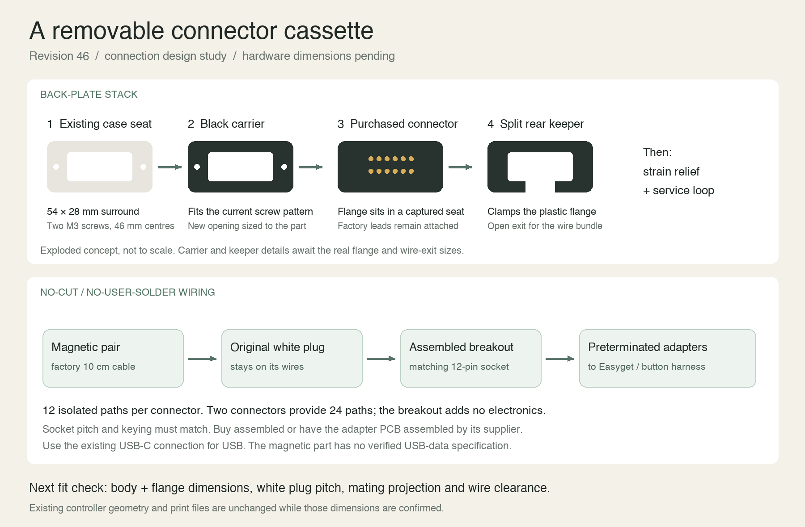

# Controller connector 46 — solderless integration study

<!-- bench-47 -->
**Bench prototype 47:** [Printable frame and wiring guide](../connector-47-bench-pack/build-guide.html) · [A1 project](../connector-47-bench-pack/connector-47-bench-A1.3mf). Adds a three-port rail, feet, wiring tray and optional Easyget sled. Basic frame hardware: 4 × M3×25, 10 × M3×10, 14 × M3 nuts; optional sled hardware is listed in its guide. Reuse existing USB cables. Connector-specific inner retention remains pending actual hardware dimensions.
<!-- /bench-47 -->

<!-- connector-sourcing-2026-11-13 -->
**13 November supplier update:** the current 54 × 28 mm surround and 46 mm screw pattern are the accepted envelope. Keep the purchased factory cable intact and use a connector-specific inner seat/keeper. [Supplier comparison and magnet-recess diagnosis](sourcing-update.html) includes the prewired Mill-Max fallback and a [sample request draft](supplier-request.txt). Hardware fit remains unverified; no controller reprint is required for this documentation update.
<!-- /connector-sourcing-2026-11-13 -->

Use the purchased magnetic connector's factory cable intact. Its white plug connects to a matching socket on a **fully assembled passive breakout**, then to preterminated adapter leads for the Easyget or button harness. No soldering or clipping the purchased leads is needed with that arrangement. A ready-made matching breakout has **not** yet been verified; PCB assembly by a supplier is an alternative, not a part we already have.

## What is verified

The [selected Amazon part](https://www.amazon.com/dp/B0DT79N394?th=1) is JHYOSSTHI **JH-WPogo-12Pin**, one magnetic male/female pair with a 10 cm cable. Product photos show white single-row 12-position housings and a flange on the black bodies. The listing does not establish the white connector family, exact body dimensions, working stroke, pin mapping, wire gauge or usable current rating. A “5 V” catalog field is not a pinout or an ampacity specification. We must not inherit the old MTCELL connector's dimensions or ratings.

## How the back plate attaches

1. Retain the existing shell's recessed seat and two M3 fixing positions. Current design: **54 × 28 × 3 mm surround, 46 mm screw centres**, Ø3.4 clearance, Ø6.4 × 1.6 head recess. The shell throat behind it is **36.6 × 18.6 mm**. [1:1 interface drawing](reference/backplate-existing-interface-1to1.svg).
2. Make the black carrier a replaceable, hardware-specific part. The connector flange seats against a positive shoulder; a removable keeper captures it from behind. Seat and keeper carry insertion/removal loads rather than the wires or contacts.
3. Split the keeper around the wire exit so it can be installed after the factory harness is passed through. First verify the white plug passes through the shell throat without depinning. A split keeper alone cannot fix an oversized shell throat.
4. Add an independent cable tie or soft strap behind the connector, gripping insulated wires gently. Keep a service loop so the back plate can be loosened without pulling the tiny plug. Put the breakout nearby, with its plug and release accessible through the removable bottom.
5. Set connector projection with measured shoulders or replaceable shims, then test full mating. The housing/registration keys must stop the assembly before the pogo pins bottom out. Both magnetic halves may need different seats.

The carrier outline and shell fixings are known. The new component aperture, flange pocket, keeper fixings and shim thickness are **pending measurement**. No new print-ready connector STL or revised controller 3MF is released in this study. Revision 45 remains the latest printable controller pack. Inner seam surrounds use the same nominal 54 × 28 / 46 mm interface; their pilots and mating stroke need separate checks before sharing a finished insert.

## Recommended breakout arrangement

**One 12-way passive adapter per cable end:** mating socket → twelve separately isolated terminal positions. Two magnetic connectors provide twenty-four independent conductors. Label both ports A/B and each conductor; continuity-test the actual mating pair rather than relying on wire colours or mirrored contact numbering.

For a completely plug-in button side, an assembled adapter can instead fan the twelve ways out to six 2-pin sockets matching the existing button leads. The Easyget side uses matching preterminated extension/adapter leads. The exact Easyget plug family must be checked too. An adapter with only screw terminals does not directly accept an existing plastic plug; it needs the mating socket or an adapter cable.

For rapid prototyping, an alternative is a **factory-made mating 12-pin pigtail with prestripped ends**, connected to individually isolated screw/spring terminals. This also preserves the purchased lead. Such a matching pigtail has not yet been identified. Loose PCB headers still require soldering to a PCB; do not order them thinking they are cable adapters.

Use terminal blocks specified for the actual conductor size and strand type. If required by the selected terminal, use correctly crimped ferrules on new adapter leads, never solder-tinned wire ends under screw clamps. Keep the factory cable unchanged.

## Which signals go through it

Treat the magnetic connectors initially as passive **switch wiring**, not automatically as USB. Two ports can carry twelve isolated 2-wire switch circuits (24 conductors), or a verified common-return arrangement can free contacts for other purposes. Eight action/start switches alone need 16 conductors if kept as independent pairs.

The [circuit allocation worksheet](circuit-allocation.csv) is a planning worksheet for twelve isolated circuits, **not the vendor's physical pinout**. The [continuity worksheet](continuity-map.csv) is where actual wire/contact mappings must be recorded first. Remap it for the chosen layout; Start is a game input and is distinct from a later coin interface.

Keep button lamp wiring separate from switch inputs. Do not infer positive/negative from colour or assume the LEDs use 5 V. After their voltage/current and connector ratings are established, allocate an appropriately fused lighting feed and return. If 24 conductors are all used for switches, there are none left for lighting without a confirmed common-return design or another path.

Keep USB on the existing USB-C connection during this prototype. The purchased connector has no verified USB-data performance. Do not join two encoders' input circuits, parallel two USB power sources, or assume two plugged-in Easyget boards can share a passive switch harness. Select which encoder owns a harness.

## Drawing or arrival checks for the next fit coupon

The part is not yet in hand. Ask the supplier for a drawing covering both halves; the same checks can be made when it arrives:

| Measurement | What to measure |
|---|---|
| Black body W × H × D | Exclude the projecting pins and cable; record them separately |
| Flange W × H × thickness | Include any latch, step, or moulding ridge |
| Wire exit | Bundle width/height and required bend space behind housing |
| Mating state | Joined overall thickness, and where plastic faces stop |
| White plug | Overall W × H × D, latch/key shape, contact count |
| White plug pitch | Centre of first to centre of last contact, divided by 11 for twelve contacts |

For identification only: 22.0 mm across eleven intervals is 2.0 mm pitch, consistent with [JST PH](https://www.jst.com/wp-content/uploads/2021/08/ePH-new.pdf); 27.5 mm is 2.5 mm pitch, consistent with [JST XH](https://www.jst.com/wp-content/uploads/2021/01/eXH-new.pdf). Pitch alone does not establish the family; keying and contact shape must agree. These are candidates, not a declaration that the purchased plug is JST.

With these dimensions, the next deliverable is a **small carrier + keeper fit coupon** for each mating half. Dry-fit the connector, white plug, cable and mating partner before changing all the print plates. Only the replaceable surrounds should need printing if the actual part clears the existing shell throat and screw bosses.

## Proposed parts, without premature purchases

| Item | Quantity / status |
|---|---|
| Purchased JH-WPogo-12Pin pair | One pair per magnetic interface; two pairs for A + B |
| Matching fully assembled 12-way breakout | One per harness end; exact socket pending identification |
| Preterminated Easyget / button adapters | Per circuit; plug family pending confirmation |
| Carrier + removable keeper | One set per mounted magnetic half, hardware fit pending |
| Existing M3 surround fixings | Two per surround; retain current shell insert locations |
| Strain relief | One soft strap or cable tie per wire bundle; no tension at plug |

## Files

- `connector-design.html`: illustrated local design guide.
- `images/connector-plan.png`: back-plate and wiring diagram.
- `reference/backplate-existing-interface-1to1.svg`: measured-from-CAD reference, not a connector cutout.
- `interface-spec.json`: known dimensions, proposed design and outstanding checks.
- `circuit-allocation.csv`, `continuity-map.csv`: wiring planning sheets.

Source check: 2026-11-13. Design decisions are proposals; purchased-part facts and CAD-derived dimensions are identified separately. Nothing was ordered.
