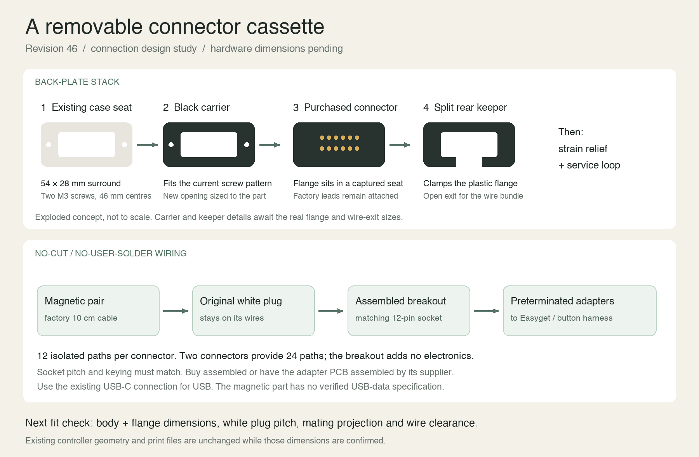

# Connector suppliers and replaceable back plate

13 November 2026 · Supplement to connector study 46 · Controller revision 45 remains the print baseline

[Main parts list](../cabinet-31-parts/parts-list.html) · [Connector design](connector-design.html) · [README](README.md) · [Supplier request draft](supplier-request.txt)

**Use the prewired pair you already purchased first.** We will keep the current shell mounting interface as the design envelope and tailor the removable insert to the connector. The Amazon listing still does not provide enough dimensions to guarantee the new component fits the old aperture. This is an accepted packaging assumption, not a request to measure a part you do not have.

## Is it a standard?

Your screenshot is from [C.C.P. Contact Probes' pogo-pin catalogue](https://www.ccpcontactprobes.com/sites/default/files/2021-09/CCP_POGO_PIN_BROCHURE_20210903-2page_download_7.pdf), pages 20–21. “Standard pins” names that supplier's product family. Its common pitches do not define an interchangeable magnetic connector housing.

There are two independent interfaces: the **2 × 6 magnetic contact array** and the **single-row white wire plug**. Each has its own pitch, housing, keying and contact dimensions. Even evenly spaced pins can differ: six contacts at 2.50 mm have a 12.50 mm first-to-last span; at 2.54 mm that span is 12.70 mm. The row separation, pin travel, magnet polarity and housing stops also have to agree. Replace both mating halves when changing connector families.

For comparison, genuine [JST XH is 2.50 mm pitch](https://www.jst.com/wp-content/uploads/2021/01/eXH-new.pdf), and [JST PH is 2.00 mm](https://www.jst.com/wp-content/uploads/2021/08/ePH-new.pdf). A seller's “XH2.54” description is not proof of genuine JST XH compatibility. Neither family has been established for the purchased part.

## Supplier options and small quantities

| Route | Exact part / supplier | Small-order status | Decision |
| --- | --- | --- | --- |
| Already purchased | [JHYOSSTHI JH-WPogo-12Pin / B0DT79N394](https://www.amazon.com/dp/B0DT79N394?th=1) | One mating pair, factory 100 mm leads and white plugs; purchased, awaiting arrival | First prototype choice. Keep the factory harness intact. No further quantity recommended yet. |
| Documented prewired spring half | [Mill-Max 889-22-012-70-501010 at DigiKey](https://www.digikey.com/en/products/detail/mill-max-manufacturing-corp/889-22-012-70-501010/16164055) | Qty 1: $53.93; catalogue displayed 5 stocked | Optional fallback; needs its matching target and a new inner seat. |
| Matching prewired target half | [Mill-Max 889-10-012-70-502010 at DigiKey](https://www.digikey.com/en/products/detail/mill-max-manufacturing-corp/889-10-012-70-502010/16164051) | Qty 1: $41.13; catalogue displayed 36 stocked | One of each makes a $95.06 mating pair, before tax/shipping. Two A/B pairs total $190.12. |
| Integrated magnetic connector / factory harness | [CCP engineering and sample inquiry](https://www.ccpcontactprobes.com/en/contact) | Ask for 2 and 5 complete pairs; MOQ, price and lead time not published for our configuration | Best lead for the supplier behind your screenshot. Request drawings and factory termination together. |
| Alternate engineering source | [Adam Tech magnetic connector/cable range](https://app.adam-tech.com/products/index/category:3068/page:2) | Sample and harness quote required | Their catalogue includes 12-position connectors; a matching prewired pair has not been verified. |

Stock and prices above are public catalogue observations checked 13 November; pages can be cached. There is no confirmed arrival date to 97217. Nothing has been ordered or sent to a supplier. These are alternatives, not a combined shopping list.

The [Mill-Max manufacturer release](https://www.heilind.eu/page/wp-content/uploads/pr704_-_pre-wired_spring-loaded_target_connectors_ms.pdf) confirms factory-crimped 203 mm, 24 AWG pigtails and 2.54 mm pitch for the 889 spring/target families. They have **no integrated retention magnets**; our printed cassette would provide separate Ø6 × 3 mm magnet holders and alignment features. This is a new cassette option, not a drop-in mate for the Amazon connector. Its published 1.4 mm maximum spring stroke is a limit, not the intended installed compression. Final standoff and retention force need the exact mating drawings and a fit test.

The old [MTCELL B0GY4LFFB2 solder-tail pair](https://www.amazon.com/dp/B0GY4LFFB2) stays in the list as an owned/reference component. It does not meet the no-user-solder goal on its own. A loose PCB header or generic female jumper is not a verified mechanical termination for those tails.

## Wiring without clipping the purchased cables

**Purchased magnetic connector → original white plug → factory-made matching socket/pigtail or fully assembled breakout → controller harness.** The supplier must identify and supply the actual mating socket. A screw terminal cannot accept the existing plastic plug directly. The matching breakout is still an open BOM item; no exact off-the-shelf part has been verified.

Specify twelve isolated paths. One option is a fully assembled adapter with twelve isolated terminal positions; another fans out to six matching 2-pin switch sockets. Both preserve the existing lead. For two A/B magnetic links, allow **two complete mating pairs and four cable-end adapters**, if both ends need adaptation. Buy just one pair's adapters for the first test.

The Mill-Max alternative already ends in individual wires, so it can use suitable isolated spring/screw terminals. That avoids soldering at the pogo contacts but does not directly mate the Amazon white plug. Its pigtails are black: label each conductor using a continuity map. A multiway common-bus connector would short different inputs together; use separate isolated circuits.

Retain direct USB for the working prototype. These proposed contact harnesses have not been qualified as USB links. Leave the LED feed unassigned until the received button voltage, actual load and connector ratings are established; do not join external 5 V to USB VBUS.

## Back plate: keep the shell, change the insert

| Existing interface, from our CAD | Retained dimension |
| --- | --- |
| Outer black surround | 54 × 28 × 3 mm; R3 corners |
| Shell recessed seat | 54.6 × 28.6 × 3.2 mm |
| Two M3 fixing centres | 46 mm |
| Screw clearance / head recess | Ø3.4 / Ø6.4 × 1.6 mm deep |
| Clear wire throat in the shell | 36.6 × 18.6 mm |
| Old connector opening | 28.6 × 8.6 mm; reference only, not the new connector specification |

Use a replaceable connector-specific liner, a positive front shoulder and a removable split rear keeper. The liner locates the body laterally; the keeper seats the housing/flange axially so it cannot rock. Keep the two original M3 plate fixings. A separate soft strap provides strain relief behind the keeper, with slack for service access.

For the first liner coupon, use **0.15 mm clearance per side** around a verified rigid connector body, with 0.10 and 0.20 mm alternatives. These are prototype FDM allowances, not production tolerances. Do not add this clearance to the pin locations. Shims adjust projection independently; a positive stop must prevent over-compressing the contacts. No adhesive or interference fit on the pogo pins is needed.

Inner seam ports share the nominal outer plate dimensions but use different pilots and mating conditions. Reuse the connector family and pin assignment, then verify each seat/stop. A mating pair must have complementary magnet polarity; it must not be possible to dock it reversed. Purchased-part drawings should establish the liner before a new print release. No existing controller shell or print plate is changed by this sourcing update.

## Your 6 × 3 mm magnet measurement

In IMG_5425, the separate disc appears to occupy the **left screw-head recess**. The right recess shows the same counterbore and smaller screw hole. Our nominal depth is 1.6 mm, so a 3 mm-thick magnet would stand **1.4 mm proud**, close to your measured **1.46 mm**. Your measurement implies about 1.54 mm of seating depth on that print. This is a likely explanation, not a calibrated measurement from the photograph.

Keep those two holes for the plate screws. If separate magnets are needed for the Mill-Max version, give them dedicated blind pockets and a retaining feature behind the connector seat. A proposed Ø6.3 × 3.2 mm pocket needs a rear boss and at least 1.2 mm backing; it cannot be cut blindly into a 3 mm plate. Magnet placement, retention and force remain a cassette design detail. The Amazon pair already incorporates magnets in its own housing.

The Ø3 × 2 mm magnets are recorded as available. Your message did not include their measured protrusion, so no pocket correction is inferred for them. Magnets provide mechanical retention; the pogo contacts carry the electrical circuits.

## Supplier request

The [ready-to-copy request](supplier-request.txt) asks for 2- and 5-pair quantities, drawings, mating height, finished harnesses and a compatible breakout. It is a draft only. A dimensional drawing plus manufacturer part numbers would let us finish the insert before the purchased hardware arrives.
