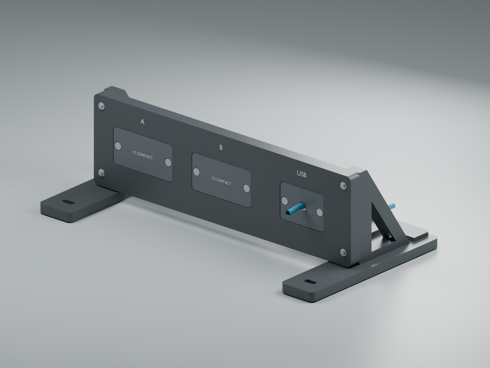
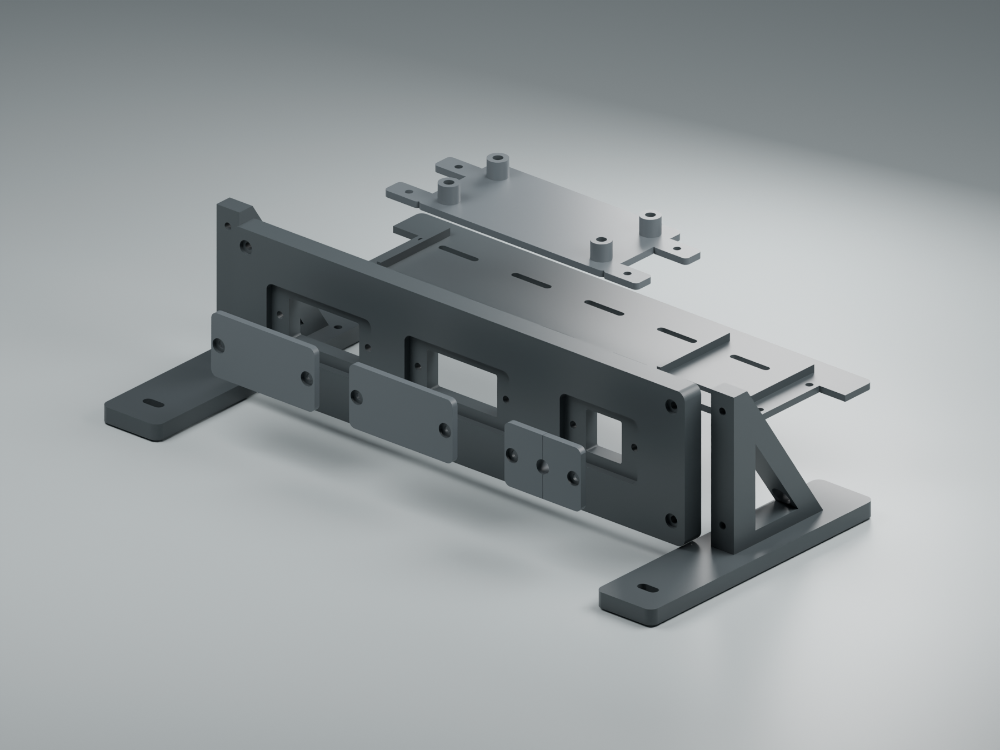
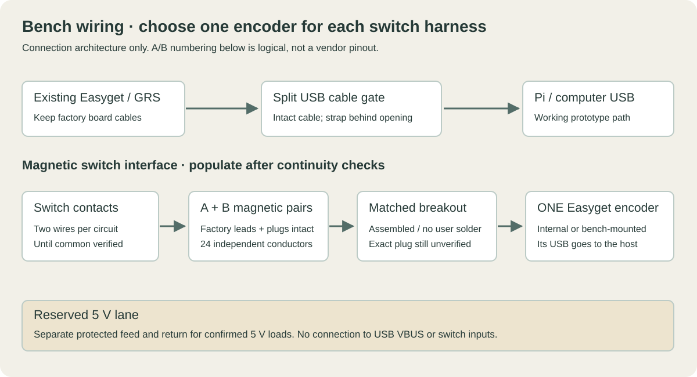

# Connector bench 47 — outer ports and wiring

13 November 2026 · Small freestanding prototype · Controller shells remain revision 45

[Bambu A1 project](connector-47-bench-A1.3mf) · [Assembled Blender](Blender/bench-assembled.blend) · [Separated Blender](Blender/bench-separated.blend) · [HTML directions](build-guide.html)

This is the first physical module for the cabinet's black internal frame: a three-port rail, two removable gusseted feet and a screw-on wiring tray. It is intended to stand under its own light bench assembly. It is **not a monitor stand or the finished load-bearing cabinet chassis**. The feet can later be replaced by cabinet uprights using the same four rail holes.

The two A/B plates in the rendering are **blank carriers**, not modeled copies of the unreceived magnetic part. Existing connector surrounds can replace them. The blue shape illustrates an intact USB cable through a split exit; it is not a new USB-C socket or a supplied cable.

## First print

Print **plate 01**, the small surround-seat coupon, first: approximately **22 minutes / 12.8 g** in the included A1 PLA profile. Try one existing magnetic surround, two M3 nuts and the fixing screws. The coupon checks our printed mount, not the new connector body.

The project is configured for **Bambu Lab A1, 0.4 mm nozzle, 0.20 mm layers, four walls, 20% gyroid**, with supports off. Select the actual filament installed before printing. All four plates sliced with no reported warnings and no generated support paths. This does not replace the physical fit test.

| Plate | Contents | Estimated material | Estimated time |
| --- | --- | --- | --- |
| 01 | FIRST TEST - existing surround seat and M3 nut fit | 12.8 g | 0 h 21 min |
| 02 | BENCH FRAME - port rail and wiring tray | 116.1 g | 3 h 08 min |
| 03 | BENCH FEET - left and right gusset brackets | 65.1 g | 2 h 05 min |
| 04 | OPTIONAL - blank carriers USB cable gate and Easyget sled | 33.4 g | 0 h 58 min |

Plate 01 is a test, not part of the finished assembly. Plate 04 is optional: reuse your existing A/B and USB surrounds where appropriate. Its split gate lets you route an intact cable now; its Easyget sled is only needed if placing the encoder on the bench. Print a single coupon before committing to the frame.

## Retained outer interfaces

| Interface | Dimensions / location |
| --- | --- |
| Rail | 236 × 68 × 10 mm; assembled bottom 8 mm above bench |
| Complete bench footprint / height | 252 × 135 × 76 mm |
| Magnetic surrounds A and B | Existing 54 × 28 × 3 mm; two M3 holes on 46 mm centres |
| A/B seats / wire throats | 54.6 × 28.6 × 3.2 mm; 36.6 × 18.6 mm clear throat |
| USB surround | Existing 40 × 28 mm; two M3 holes on 32 mm centres |
| USB seat / wire throat | 40.6 × 28.6 × 3.2 mm; 18.6 × 18.6 mm clear throat |
| Port spacing | A to B: 72 mm; B to USB: 74 mm, same as controller rear |
| Bench port centre height | 42 mm above the bench; not the cabinet's final docking height |
| Frame attachment pattern | Two columns 222 mm apart, two holes per column 50 mm apart, Ø3.4 mm |
| Removable tray | 236 × 60 mm, 3 mm floor plus shallow dividers; ten 20 × 3.4 mm strap/fixing slots |
| Optional Easyget sled | User-specified 79.6 × 29.6 mm hole centres; four Ø4.4 × 7 mm insert pockets; posts 8 mm above sled floor |
| Split cable exit | Nominal Ø6.6 mm with a small split seam; use a sleeve for smaller cable and independent strain relief |

The bench keeps all three rear-port positions relative to one another, but does not reproduce the controller's entire width or dock travel. It accepts outer surrounds. Component-specific contact alignment, magnet polarity and working compression remain a separate insert check.

The new nut pockets use **5.8 mm across flats × 2.6 mm depth**, a prototype clearance for common M3 hex nuts. Use the coupon to check your actual nuts. None of the frame joints needs heat-set inserts. Only the optional Easyget sled uses the same M3 insert pockets as the current controllers.

## Hardware to gather

| Item | Frame quantity | Purpose |
| --- | --- | --- |
| M3 × 25 mm button-head screws | 4 | Rail to the two feet |
| M3 × 10 mm button-head screws | 4 | Tray to feet; nominal end flush with underside |
| M3 × 10 mm button-head screws | 6 | Two screws per port surround into rear nuts |
| Common M3 hex nuts | 14 | Six rail-port pockets, four foot upright pockets, four foot underside pockets |
| Thin rubber pads or grip tape | 4 pads / two strips | Optional under feet; existing 18 mm pads fit the 30 mm foot width |
| Small cable ties / soft straps | As needed | Through the tray slots; do not pull on connector pins |
| Existing USB lead(s) | Reuse | Easyget and, for the optical controls, GRS to the host |

For the optional Easyget sled add **four M3 × 10 screws, four M3 nuts and four M3 washers** to fasten its ears through the tray slots. Add four appropriate M3 brass inserts and four M3 × 6 PCB screws, checking engagement against the real board/washer stack. The mounting pattern comes from the fitted controller revision; the simplified green object in Blender is only a PCB envelope.

M3 screw lengths are starting hardware stacks, not permission to force a bottomed screw. Keep washers off the tray-to-foot stack unless adjusting screw length accordingly. Confirm the tray screws are flush or recessed beneath the feet before placing the stand on a finished surface. The original short case screws may be too short for this through-nut bench rail.

The purchased [12-pin magnetic pair](https://www.amazon.com/dp/B0DT79N394?th=1), its **matching assembled breakout or socket/pigtail**, and any new connector-specific keeper remain separate hardware. See the [supplier list](../connector-46-design-pack/sourcing-update.html). A/B blank carriers close unused openings while that hardware is being resolved. Do not order another pair just to assemble this bench frame.

## Assemble the bench

1. Check the coupon. The surround should seat squarely without forcing its locating step. M3 nuts should load from the rear, and screws should clamp the surround without cracking it. Remove any first-layer lip before changing nominal dimensions.
2. Load the four M3 nuts into the rear-access pockets in the two upright brackets. The larger round access holes lead to the hex seats. Temporary tape can hold the nuts during assembly.
3. Put the flat rear of the port rail against the upright faces. Fit four M3 × 25 screws through the rail. Tighten evenly until the frame is square; leave the port openings accessible.
4. Load the four tray nuts from the feet's undersides. Rest the tray on the 7 mm-high foot bases and fasten it with four M3 × 10 screws. The shallow routing dividers face up.
5. Fit the existing A/B surrounds, or the supplied blanks, with two M3 × 10 screws and rear nuts each. Replace them with hardware-specific carriers later. The old solder-tail connector still needs its own proper electrical termination; this stand does not convert it to a solderless contact.
6. For a temporary USB route, remove the USB surround, place the intact cable between the split gate halves, and fasten each half using its original screw position. Use a soft sleeve if needed. Secure the insulated cable to the tray separately, leaving relaxed slack between the opening and strap. The gate should not crush the cable.
7. Fit the optional sled through the tray slots only if you want Easyget outside the cartridge. Install its inserts with the sled removed from the frame. Fit the board without straining the PCB, then test it with its original USB cable.
8. Add rubber pads or grip tape. Use the front foot slots to screw the assembly to a scrap board, or clamp the feet, when testing repeated insertion force. The small stand is not weighted enough to guarantee that every magnetic connector can be pulled apart one-handed.

The letters and labels in the renders are editable Blender text, not engraved or separately printed objects. Label the physical ports A and B with tape before wiring. The assembled Blender includes hardware and cable reference objects; only the STL folder contains printable parts.

## Connections and wire routing

**Working USB test:** keep Easyget connected through its factory USB lead. For Centipede/Tempest, keep the GRS interface on its own existing USB lead as needed. Use one host per USB connection. The split gate routes a cable; it adds no electronics and does not change USB-C wiring. Reuse the existing USB-C surround when its fitted component is ready.

**Magnetic switch test:** preserve each purchased factory cable and white plug. Mate it to the correct factory-made socket/pigtail or a fully assembled passive breakout. Use separate isolated terminal positions, then matching adapters for the existing button/Easyget leads. The exact white plug family is still unknown; the current work does not release a fabricated PCB or a guessed JST adapter.

For a raw-switch cartridge, one Easyget encoder can sit on the bench sled. For a self-contained cartridge, leave Easyget inside it. Choose which encoder owns those switches; do not connect the same switch wiring to two encoders at once. The seam connectors between left/right controller halves and the outer bench ports are separate interfaces, even if they later use the same hardware family.

The tray's central area accepts the Easyget sled **or** a strapped/measured breakout; it is not a claim that an arbitrary breakout fits beside the board. The right lane between X50 and X94 is reserved for intact USB. The narrow left lane beside X−96 can hold a separately insulated auxiliary pair later. Keep both cable ends and plug releases accessible through the open back.

### Logical circuit allocation — not a physical pinout

| Logical port | Isolated pairs | Proposed use |
| --- | --- | --- |
| A | A01/A02, A03/A04, A05/A06, A07/A08 | Up, Down, Left, Right switch circuits |
| A | A09/A10, A11/A12 | Start 1 and Start 2 / Menu, depending on layout |
| B | B01/B02 through B11/B12 | Six independent action-button circuits |

This conservative arrangement uses all 24 conductors; **there is no spare LED supply pair in that allocation**. An existing 5-wire joystick needs a verified adapter/fanout from its common and four switch signals; do not clip that factory harness. A verified common-return scheme could free contacts, but that is a later electrical change. The existing coin interface stays on its separate USB path.

Use the [continuity worksheet](../connector-46-design-pack/continuity-map.csv) to assign actual wire/contact positions. Number both ends from a defined latch/mating-face view; mating faces can appear mirrored. Power off, map each contact end-to-end, check adjacent paths remain isolated, then test one switch circuit. Repeat while gently moving the cable before connecting the remaining switches.

### Reserved low-voltage power route

Provide a separate fused branch for confirmed 5 V lamps, with its own feed and return and a service disconnect. Lamp voltage, measured current and connector ratings remain to be established; no magnetic contact is assigned power in this release. Keep this separate from USB VBUS and signal inputs. Thin controller switch leads are not the cabinet lighting trunk. Cabinet power-supply and LED purchases remain in the [existing parts list](../cabinet-31-parts/parts-list.html); this bench adds no mains wiring.

## Transition into the cabinet

The finished bench rail becomes a removable service module. Future black cabinet uprights can accept its **222 × 50 mm four-hole pattern**, replacing the bench feet. Keep the board/breakout tray removable and reachable from the cabinet service opening. The slot pattern lets a measured breakout adapter replace the Easyget sled without redesigning the outer ports.

This is a modular connection standard for our printed parts, not a universal pogo-connector standard. Before making full-height uprights, locate this module against the actual controller rear ports, drawer travel, cable bends and cabinet service panel. The bench's 42 mm centre height is deliberately a bench datum, not a cabinet mounting coordinate. The current cabinet seat, monitor mounting and ballast remain independent work.

No existing controller, fitted control mount, overlay magnet or cabinet contour changes in this revision. The connector-specific inner liner, keeper and contact projection will be sized from a supplier drawing or the delivered component; only the removable surrounds should need replacement if the hardware clears the retained shell throats.

## Validation and files

- Ten STL parts: one connected, closed mesh each, consistent winding and positive volume. No detected volume intersections between the assembled printed parts. [Mesh checks](mesh-checks.json).
- All part extents fit within the A1's 256 mm cube; the largest is 236 mm in-plane. [Geometry and retained coordinates](geometry-checks.json).
- Four plates sliced for the A1 with no reported warnings or support paths. [Slice checks](slice-checks.json).
- Assembled and separated Blender files and three rendered views are included. [Rear wiring view](images/bench-rear-wiring.png).
- Physical nut fit, printed stiffness, mating retention and stability under cable pull remain bench tests. No new electrical connector or monitor load has been certified by the rendering.

Rebuild with `work/build_v47_bench.py` in Blender, `work/package_v47_bench.py` in Python, then `work/docs_v47_bench.py`. Nothing has been purchased, sent to a supplier, or sent to the printer.
