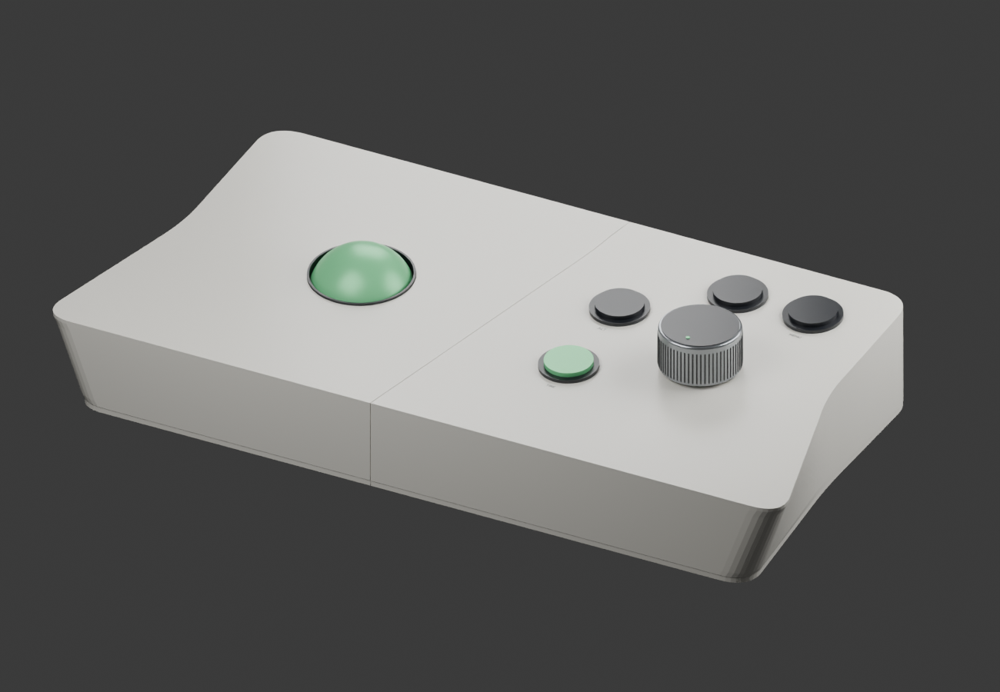
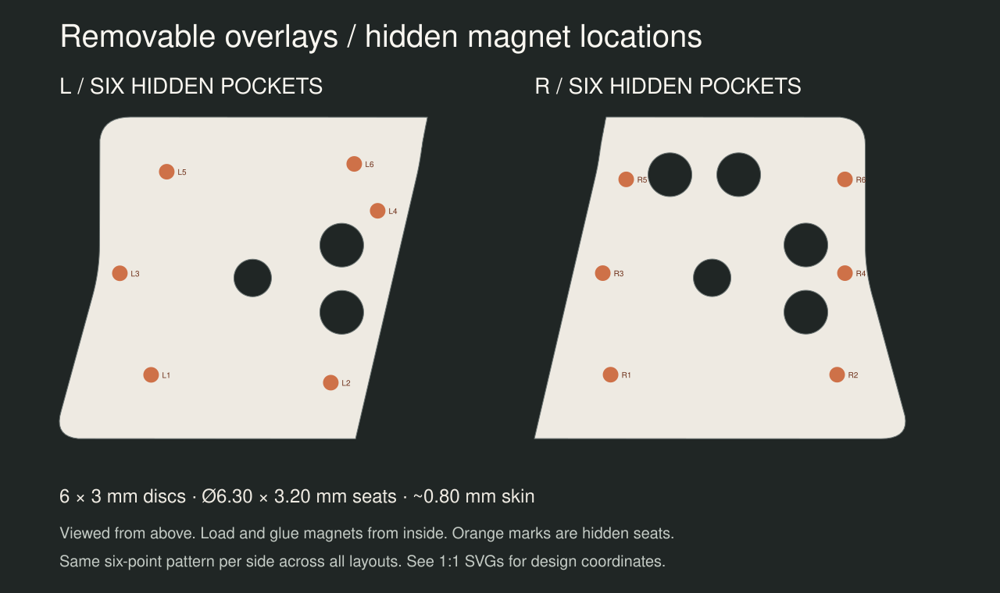
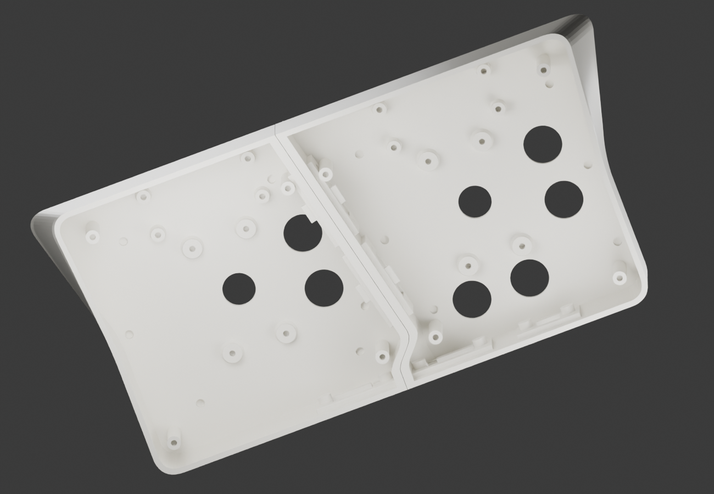
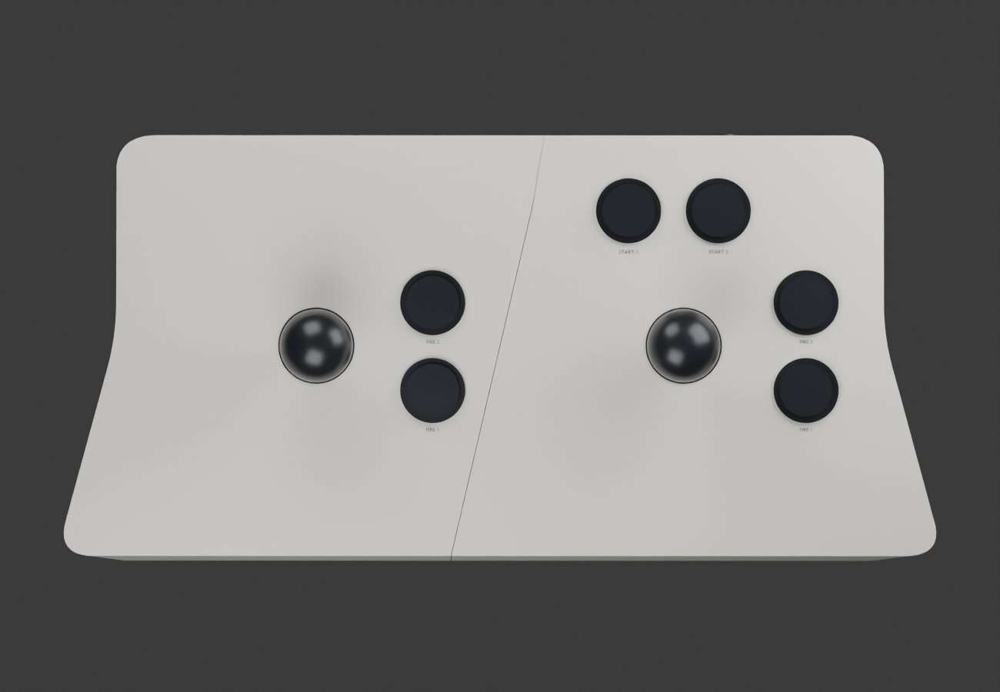
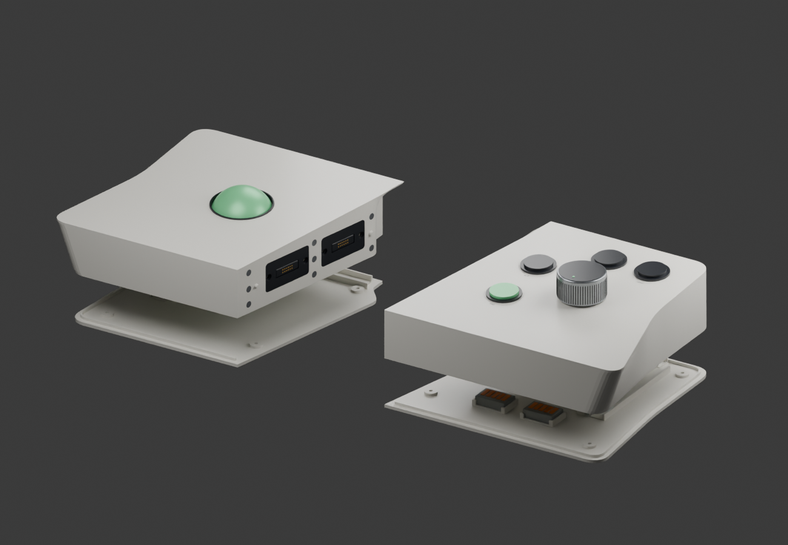
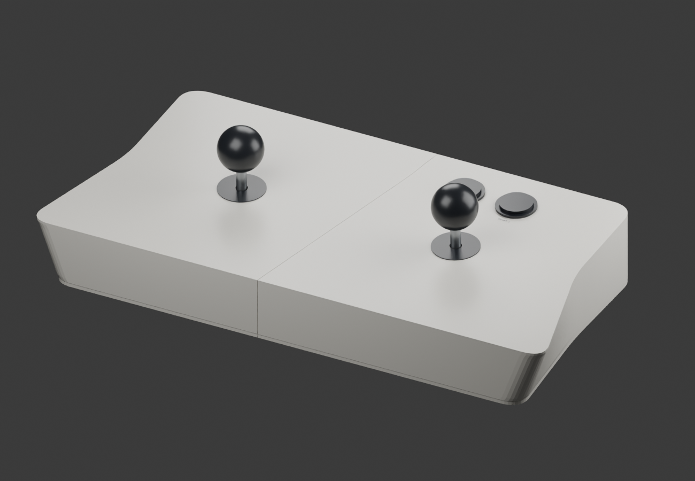
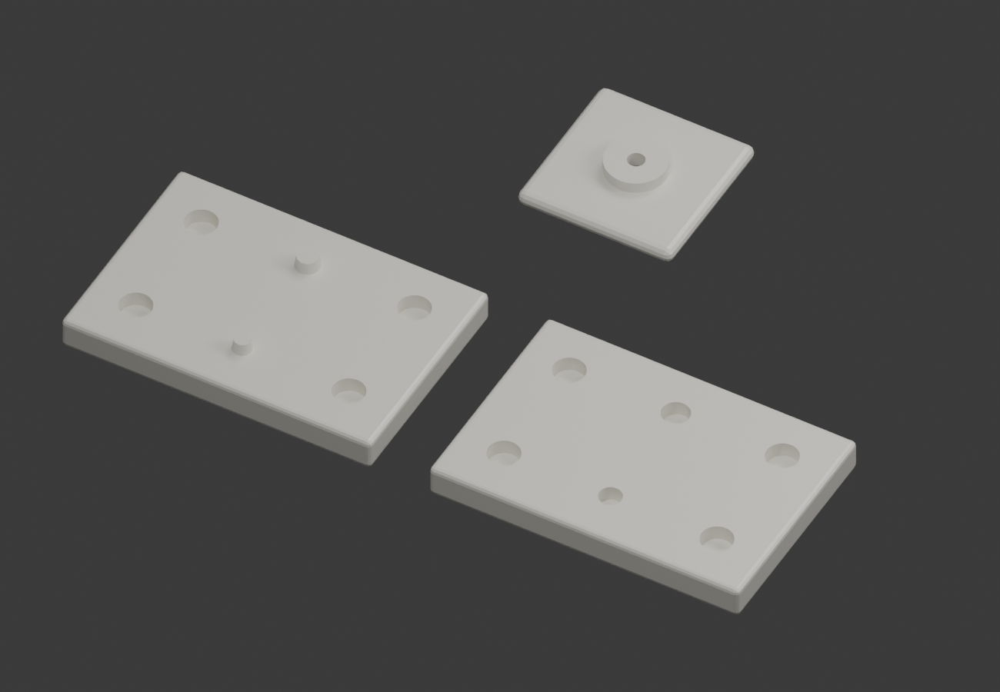

# Magnetic controller halves · Revision 45

13 November 2026 · Bambu Lab A1 · 0.4 mm nozzle · PLA

[All controllers: 23 named plates](controller-45-all-controllers-A1.3mf) · [Small magnet and screw tests](controller-43-fit-tests-A1.3mf) · [HTML guide](build-guide.html)

## Revision 45: hidden overlay magnets

Every upper half now has **six hidden, underside-loading seats for Ø6 × 3 mm solid disc magnets**. Use up to six per half: twelve for a complete left/right controller, in addition to the existing eight seam magnets on each half. The holes are **Ø6.30 × 3.20 mm deep**, leaving approximately **0.80 mm of continuous plastic** above the magnets. The playing surface remains smooth. Insert and bond magnets from inside before refitting the bottom.

The six locations on a given side are common across all eight layouts. They avoid modeled control hardware, PCB envelopes and mounting posts, with an 11 mm diameter, 25 mm deep clear approach from the inner deck. All fitted control openings, supports (including the corrected 10.83 mm trackball supports), insert pilots, connectors and outer contours are retained. Bottoms are unchanged.

**Reprint only the top halves for which you want magnetic overlays:** plates 02–12 and 22–23 now include these pockets. Existing revision43/44 bottoms remain compatible. All other plates are unchanged. The exterior appearance of the assembled renderings is unchanged; each Blender file now also has an **04 underside overlay pockets** inspection scene.

### Installing the overlay magnets

1. Use the existing small fit coupon to check a Ø6.3 × 3.2 mm seat. These are clearance pockets for adhesive, not an interference fit. The top shell prints playing-face down; the thin skin is printed first, so the blind pockets do not create a suspended ceiling.
2. Dry-fit magnets from the inside and check polarity against the matching overlay magnets. Mark a consistent outward-facing pole across all twelve top locations. Orient overlay magnets to attract that face.
3. Bond each magnet to the blind end with a small amount of suitable adhesive, keeping the inner face and nearby hardware clean. Do not force a tight magnet or press against the thin outer skin. Let it cure before closing the case.
4. For printed overlays, use matching magnets captured in their undersides or suitable steel targets. Keep the target close to the playing face; holding force depends on magnet grade, plastic separation, overlay weight and position, and needs a physical trial. Small decals can use fewer than six locations.
5. An overlay is cosmetic and removable. Check clearance around button bezels, spinner, joystick dust washer and trackball ring before final printing; do not bury or rub the moving controls. Thick overlays may require larger openings or islands around controls. The deck itself is not recessed.

### Overlay design references

The **Overlay-templates** folder contains one SVG for each half/layout at 1:1 millimetres, looking down at the playing face. **Black lines are deck/control boundaries; red circles and crosses mark hidden magnet centres only.** Do not cut the red circles through a finished overlay. These are design references, not finished printable overlays. The Blender shells provide the exact 3D surface if you want to build an overlay directly on it.

[Left twin-joystick template](Overlay-templates/twin-joystick-2fire-L-overlay-reference.svg) · [Right twin-joystick template](Overlay-templates/twin-joystick-2fire-R-overlay-reference.svg) · [Dimension and clearance checks](controller-45-overlay-checks.json)

| Position | Left half X, Y (mm) | Right half X, Y (mm) |
| --- | --- | --- |
| 1 | 45, 25 | 225, 25 |
| 2 | 160, 20 | 370, 25 |
| 3 | 25, 90 | 220, 90 |
| 4 | 190, 130 | 375, 90 |
| 5 | 55, 155 | 235, 150 |
| 6 | 175, 160 | 375, 150 |

These coordinates use the original assembled Blender model: X increases left to right and Y increases front to back. The face is Z = 180.8 + 0.05Y mm; pocket axes are perpendicular to it. The SVG includes the small slope correction for true flat pattern dimensions. An overlay magnet can be Ø6 mm; the red reference circle shows the shell's Ø6.3 mm seat.

## Retained revision 44 trackball correction

The four trackball supports project **10.83 mm** from the inner deck, reduced by **0.20 mm** from revision43. Their hole centres, Ø12 mm post diameter and Ø4.4 × 7 mm insert pockets are unchanged. The surrounding enclosure, bottom pieces, magnetic interfaces and other controls are unchanged.

For the previous height-only change, the affected tops were: plate **06** (Centipede, right Fire), **08** (Centipede, left Fire), or **11** (Tempest, trackball right). These tops fit the existing revision43 bottoms. Revision45 additionally updates all upper halves with overlay magnet pockets, as described above. The earlier straight-seam revision42 compatibility limitation below still applies.

[Measured support-height checks](controller-44-height-checks.json). The revision43 check files below document unchanged baseline features; the new height check supersedes their trackball-height entries.

## Additional twin joystick with two Fire buttons per half

Print **22 + 23** for the new left/right tops and use the existing **13 + 14** bottoms. Each half has one joystick and two regular Ø28 mm Fire buttons, spaced 43 mm centre-to-centre. Both original Start buttons remain on the right half. The earlier twin-joystick layout remains on plates 02 + 12.

[New twin joystick Blender model](Blender/twin-joystick-2fire.blend) · [Button clearance checks](controller-44-twin-fire-checks.json). The modeled allowance is a Ø28 mm body extending 42 mm below the deck and a Ø32 mm retaining nut; actual terminals and bends still need a dry fit. Connect both new switches on each half to distinct available encoder inputs; do not parallel the two USB boards. The optional right Easyget mounts remain available for a second encoder.

## The new join

Two independent four-wall enclosures join along a diagonal seam. The playing-surface seam runs from X176 at the front to X224 at the rear, over the existing 206 mm depth. The existing rounded, flared outside contour, flat 4 mm deck, 5% grade, control positions and three rear port locations remain. A return beneath the rear deck clears the original port surrounds; the visible seam remains diagonal.

Each half has eight inward-wall seats for **6 mm diameter × 3 mm solid disc magnets** (separate from the six new underside overlay pockets), two removable black connector surrounds on its inward wall, and an independently removable screw-fastened bottom. There are **two mating connector pairs** across the join: four physical connector halves, with 24 possible contacts. The separate disc magnets provide retention; they are not electrical contacts. Two tapered registration keys carry alignment and shear, replacing the old internal splice brackets.

## Compatibility and what to reprint

Your fitted controls, trackball mounts, joystick mounts, buttons, Easyget boards, rear surrounds and optional rubber-pad feet can transfer. The cabinet's rear connection coordinates and overall controller envelope are retained. The old revision-42 files remain available separately for already printed shells.

**The diagonal design needs both new top shells and both matching revision-43 bottom pieces.** A new diagonal half will not mate with an old straight-seam half. The four inner bottom-screw positions move to clear the wall and insert press. Do not reuse an old bottom or the roof/floor splice brackets with this enclosure.

Each Blender file has assembled, separated service, top-view and underside magnet-pocket scenes. These are actual editable part meshes, with purchased components shown as reference envelopes.

## Choose a layout

LEFT and RIGHT are the player's left and right. All pushbuttons retain the regular 28 mm mounting holes.

| Layout | Top plates | Bottom plates | Blender |
| --- | --- | --- | --- |
| Street Fighter, six actions + two Start | 02 + 03 | 13 + 14 | [Six-action](Blender/joystick-6.blend) |
| Fire / Jump + two Start | 02 + 04 | 13 + 14 | [Two-action](Blender/joystick-2.blend) |
| Three actions + two Start | 02 + 05 | 13 + 14 | [Three-action](Blender/joystick-3.blend) |
| Centipede, right Fire | 06 + 07 | 15 + 16 | [Centipede](Blender/centipede.blend) |
| Centipede, left Fire | 08 + 09 | 15 + 16 | [Left Fire](Blender/centipede-left-fire.blend) |
| Tempest, left dial / right trackball | 10 + 11 | 17 + 18 | [Tempest](Blender/tempest.blend) |
| Twin joystick + two Start | 02 + 12 | 13 + 14 | [Twin joystick](Blender/twin-joystick.blend) |
| Twin joystick, two Fire per half + two Start | 22 + 23 | 13 + 14 | [Twin joystick + Fire](Blender/twin-joystick-2fire.blend) |

Plate 19 has the four inner surrounds and four optional closed covers. Plate 20 has the unchanged rear A, B and USB-C surrounds. Plate 21 has eight optional feet. Print either an open surround or a blank for each inner port.

The twin layout places one joystick in each half. Both use the fitted 41.01 × 81.68 mm pattern with the long dimension front-to-back, and 24 mm shaft openings. The right half also has optional Easyget M3 supports matching the left. Two sticks alone do not create two USB players: configure one encoder for a twin-stick game, or use two encoders with separate USB host connections/a suitable hub for independent players. Each Easyget direction header is for one stick; the second stick must use distinct available inputs when sharing an encoder.

## Print the small tests first

1. Open the fit-test 3MF as a project and retain 100% scale. It uses your A1 / 0.4 mm / PLA profile.
2. Check a 6 × 3 mm disc in a Ø6.3 × 3.2 mm pocket. It should seat without splitting the plastic. Adhesive retention is intended; do not hammer a magnet into a tight print.
3. Pair the coupons before gluing. Their four magnets per coupon must attract their counterparts. The full enclosure uses eight per half. Mark the exposed mating poles so the full set uses the same polarity convention.
4. Test the 4 and 5 mm tapered registration keys in their matching pockets. The pockets have 0.25 mm nominal radial allowance. The keys should seat without forcing or holding the faces apart. The complete enclosure leaves a 0.4 mm nominal seam gap.
5. Test your actual low button-head screw in the separate bottom coupon. The head recess is Ø7 × 2.2 mm deep, intended for approximately Ø6 mm heads no more than 2 mm tall. This assumes your 6 mm measurement was the head diameter, consistent with the previously described low rounded heads.
6. Check attraction and removal by hand. The coupon checks printed fit and polarity; it does not establish the complete controller's holding force under play. Validate the full join with the real magnets and contacts before relying on it.

## Print and assemble the enclosures

Use the supplied orientations: playing surfaces down for upper shells; outer bottom faces down for bottoms. Retain supports for side/rear openings and the new inner-wall returns. Keep the 0.20 mm layers, four walls, five top/bottom layers and 20% infill, with the supplied brim. Every print part fits the A1 bed at full scale.

1. Print the matching four large pieces for your chosen layout. Remove brim/supports and clear channels and bores. Dry-fit the bare shells, keys, bottoms and rear surrounds before installing electronics.
2. Install the same M3 inserts used in the previous case: nominal M3 thread, 6 mm length × 5 mm outside diameter, with Ø4.4 × 7 mm printed pilot pockets. Insert outside dimensions still need to match your kit; the nominal thread is not the pilot diameter.
3. Fit and glue eight disc magnets into each inward wall after checking polarity against the opposite half. The pocket backs provide support. Keep adhesive and debris off the mating faces, locating keys and connector openings. Allow the adhesive to cure before testing separation.
4. Fit two internal surrounds per half using two M3 screws each. Use the closed covers while the electrical connector is not installed. The covers and open surrounds share the same boundary and screw pattern.
5. Transfer the controls using their established mount hardware. The left Easyget retains its top-mounted position, 79.6 × 29.6 mm pitch, 8 mm stand-off and M3 pilots. M3 screws pass through the owner's PCB holes. Components face inward, away from the playing deck.
6. Route wires along the existing 12 mm side/rear channels and use the new tie eyes behind each side connector. The rear channel now terminates at each inner wall. No cable should cross the mating seam without a deliberate removable connection.
7. Fit each bottom independently. Use M3 × 8 mm screws as the starting length for bare-bottom use. Check they clamp the floor before bottoming in the insert.
8. Bring the halves together laterally. The tapered keys align the surfaces before final seating. Check all magnets and connector faces seat evenly. Remove a half by a controlled lateral pull; do not twist the joystick or trackball to break the joint.

The cabinet's separate underside sliding keys remain in the Blender model as hidden optional reference parts. They protrude below the flat bottom when fitted. Remove those keys for flat tabletop use without feet; use them for the established cabinet slide interface. Test magnetic retention against actual play forces before using it as the only restraint.

## Bare bottom or optional rubber feet

The bottom has raised internal washer seats, leaving about 3.2 mm of plastic above each screw-head bearing face. Its lower surface stays at the original datum. The head pocket is 2.2 mm deep; a 1.8 mm head sits about 0.4 mm above the tabletop plane, inside the recess. The shell studs start above those raised seats, with 0.2 mm assembly clearance.

| Assembly | Starting screw | Nominal insert engagement |
| --- | --- | --- |
| Bare bottom, no foot | M3 × 8 mm | 4.6 mm |
| Existing Ø20 mm printed foot | M3 × 12 mm | 5.0 mm |

Verify your actual screw head and length before tightening. The optional feet still use 18 mm diameter × 0.05 inch (1.27 mm) adhesive rubber pads in the previous 20 mm housings. Their geometry is unchanged; the four inner screw locations move with the new bottom. Peel the pad to access the screw. Flat plastic avoids exposed metal but rubber gives more grip and surface protection.

The original cabinet clearance for the feet remains available because the overall underside envelope has not increased. Bare-bottom use removes the foot stack; it does not move the controller's rear connection coordinates.

## Connector dimensions and electrical status

| Interface feature | Dimension / status |
| --- | --- |
| Inner surround, each | 54 × 28 mm |
| Fixing pattern | Two M3 screws, 46 mm centre spacing |
| Component aperture | 28.6 × 8.6 mm, same allowance as existing rear magnetic surround |
| Reference connector body | 28 × 8 × 4 mm; provisional envelope from the earlier design |
| Disc-magnet pocket | Ø6.3 × 3.2 mm for a Ø6 × 3 disc |
| Inner wall | 6.5 mm in X before local port reinforcement |
| Join gap | 0.4 mm nominal in X |
| Key sizes | 4 and 5 mm root diameter; tapered noses |

The inner surrounds reuse the rear surround's mounting size and component opening. **The purchased 12-pin male/female body, solder/pigtail exit, retention method and working contact stroke still need verification.** Matching the old aperture is not evidence that an unmeasured connector is ready for blind mating. The adapters remain removable so its final details can be changed without another enclosure print. The two pairs should be keyed/labeled A and B when the electrical assignment is established.

For the first prototype, retain the working Easyget USB wiring and test with the bottoms open. Unplug temporary wiring before separating the halves. The magnets and keys can be evaluated with the closed port covers before the electrical connectors arrive.

For a one-encoder joystick cartridge, eight right-hand switches (six actions plus two Start) can use sixteen independent conductors across the two connectors, leaving eight contacts unassigned. Treat each switch as its own two-wire loop until the actual board's common-return arrangement is verified. A right joystick uses four distinct direction inputs. Lighting is a separate circuit; do not infer polarity from wire colour.

For optical layouts, keep the proven GRS harness/USB path until the connector pinout and signal suitability are established. A 12-pin magnetic connector is not automatically a USB-rated connector. USB power from different hosts or supplies must not be joined directly. Sharing a mechanical connector style with the cabinet does not authorize parallel wiring of USB devices, encoder outputs or power sources. No live pin assignment or current rating is released by this mechanical revision.

## Retained measured controls

| Part | Retained fit |
| --- | --- |
| Joystick | 41.01 × 81.68 mm corner-hole centres; long axis front-to-back; 6 mm support projection |
| Trackball | Confirmed 87.127473 mm square hole pitch; Ø12 mm posts; 10.83 mm support projection |
| Trackball opening | Ø57.10 mm for the measured Ø56.69 mm ring |
| Dial mounting opening | Ø28 mm; knob diameter is separate |
| Buttons | Ø28 mm regular mounting openings, existing spacing retained |
| Easyget | 79.6 × 29.6 mm centres; 8 mm top stand-off; M3 pockets |

The short 150 mm joystick lead still reaches the nearby top-mounted board using the same direct route. Actual plugs, body depth, wire bends and connector pressure remain physical dry-fit checks.

## Hardware for one complete pair

| Item | Quantity / notes |
| --- | --- |
| 6 × 3 mm disc magnets | 16 for the seam + up to 12 hidden in the two tops = 28 in the controller; up to 12 more in matching overlays. Optional test coupons use eight more. |
| M3 heat-set inserts | 30 for a single joystick/trackball layout with one Easyget; twin joystick adds four, and its optional second Easyget adds four more |
| Bottom screws | Eight M3 × 8 for bare bottoms, or M3 × 12 with feet |
| Inner surround screws | Eight M3 × 8, verify the actual adapter stack |
| Rear surround screws | Six M3 × 8, same as before |
| Easyget screws | Four M3 × 8 per installed board, with suitable washers |
| Control mounting screws | Transfer fitted hardware; verify bracket/washer thickness and 4–6 mm engagement |
| Magnetic electrical connectors | Two mating 12-contact pairs for the side interface, after vendor fit/stroke verification |
| Rubber feet | Optional eight 18 × 1.27 mm pads in printed Ø20 mm housings |
| Cable ties and adhesive | As needed for strain relief and magnet retention |

## Validation files

[Mesh checks](mesh-checks.json) · [A1 slicing checks](slice-checks.json) · [Mount and mating-path checks](controller-43-clearance-checks.json) · [Design dimensions](controller-43-checks.json) · [Fit-test dimensions](controller-43-fit-checks.json) · [Plate manifest](plate-manifest.json)

The checks cover watertight printable parts, retained mount pitch/depth, shell-to-floor clearance and lateral joining geometry. They do not replace a physical test of magnet strength, purchased connector engagement or actual electrical wiring.
