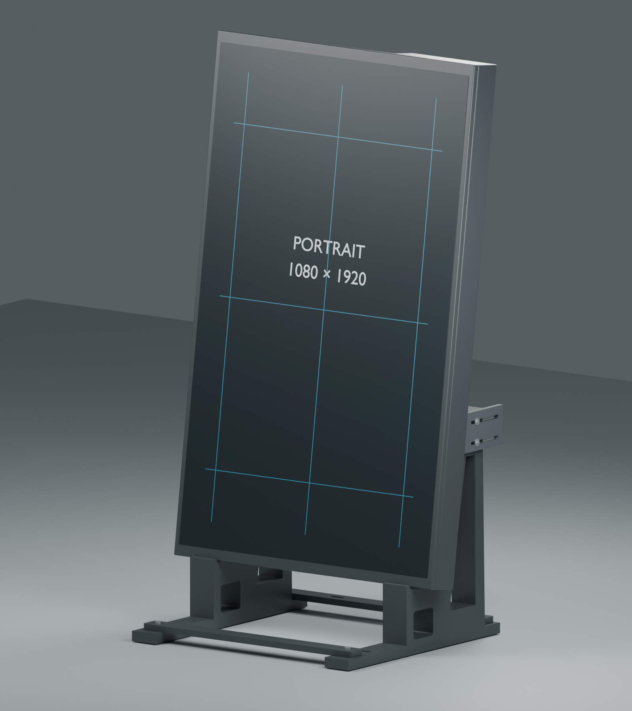
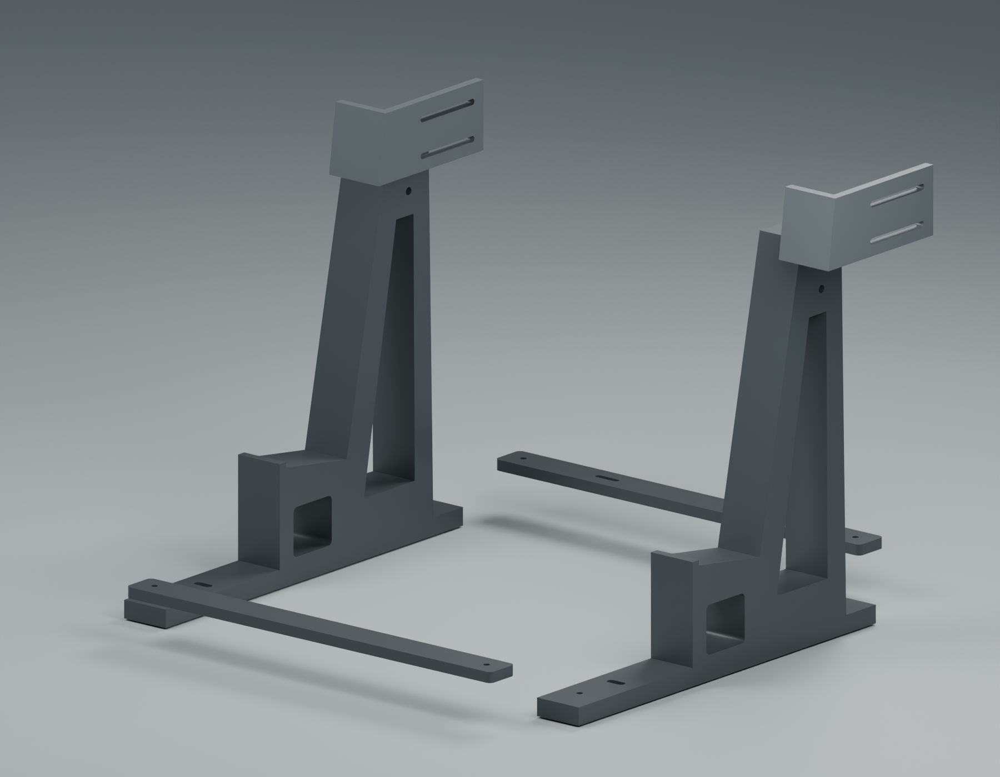
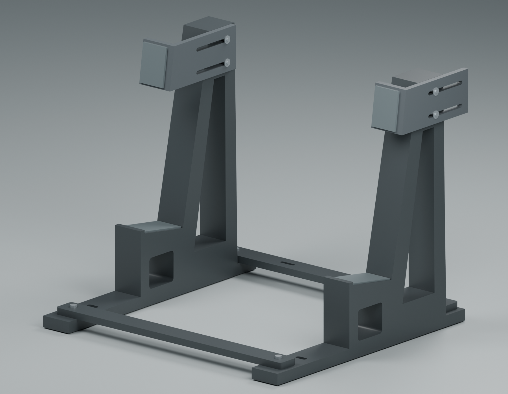

# Portrait monitor stand 48

A small freestanding cradle for testing your Acer SB220Q in portrait. This is a separate monitor stand; the connector bench does not carry the screen.

[Bambu A1 project](monitor-48-portrait-stand-A1.3mf) · [Assembled Blender](Blender/portrait-stand-assembled.blend) · [Separated Blender](Blender/portrait-stand-separated.blend)

## What this supports

Acer lists the SB220Q at **498 × 302 × 36 mm and approximately 2 kg without its pedestal**, with **no VESA mounting holes**. In portrait, that gives a 302 mm-wide × 498 mm-tall body. [Acer specifications](https://www.acer.com/gb-en/monitors/entertainment/sb0/pdp/UM.WS0EE.008).

The stand holds it with an **8° backward lean**. Two padded shelves carry the lower plastic edge; two independently adjustable, padded rear shoes support the back. Two crossbars tie the feet together. There are no screws into the monitor, no magnets carrying its weight, and no need to modify the controller or cabinet.

The padded front edge sits approximately **65 mm above the desk**, clearing the roughly 60 mm controller case. The assembled footprint is **254 × 240 mm**. The rear braces are 220 mm tall. Six printed parts make the stand; the seventh STL is a small fit coupon. The rendered monitor is a dimensional reference with a simplified rear thickness step, not an exact scan of the Acer housing. The actual local thickness, vents, plugs and rim must be checked on your monitor.

## Print the small fit piece first

Use **plate 01**. It contains the actual lower shelf/lip cross-section, an M3 insert test pocket, and an M3 hex-nut pocket.

With the screen powered off and safely supported, hold this coupon against the edge that will be at the bottom in portrait. Do not balance the monitor on the coupon. Add approximately **1.27 mm / 0.05-inch soft rubber or dense foam** to the shelf, plus a thin soft lining on the short front lip. Verify that the edge lands on the plastic casing and that the lip remains below the active display/glass area. The design exposes roughly 2 mm of retaining lip above the padded lower edge, depending on padding compression. If the real casing cannot be supported without loading glass, stop here and revise the cradle from that measurement.

Fit one of your known M3 inserts into the coupon's **Ø4.4 × 7 mm** pocket. Test an M3 nut in the **5.8 mm across-flats × 2.6 mm** recess. These are the established printed clearances, not a claim that all M3 inserts have identical outside dimensions.

## A1 print plates

The project uses **Bambu Lab A1, 0.4 mm nozzle, 0.20 mm layers, six walls, 30% gyroid and six top/bottom layers**. It is sliced in PLA with supports off. The long braces print on their broad sides so the brace outline lies in the layer plane. Keep the saved orientations. All pieces fit the 256 mm bed; the longest is 244 mm.

| Plate | Contents | Material | Estimated time |
| --- | --- | --- | --- |
| 01 | FIRST TEST - padded cradle lip and M3 insert | 14.7 g | 0 h 26 min |
| 02 | STAND - left braced leg - print on side | 224.3 g | 6 h 19 min |
| 03 | STAND - right braced leg - print on side | 224.3 g | 6 h 19 min |
| 04 | STAND - two crossbars and adjustable rear pads | 91.8 g | 2 h 24 min |

Plate 01 is a fit test only. Plates 02–04 make one complete stand. Select the actual installed filament in Bambu before printing. If using PETG, select and re-slice with its proper material profile; do not send the PLA temperatures unchanged. PLA is intended here for an indoor bench prototype, away from heat sources.

## Hardware and padding

| Item | Quantity | Use |
| --- | --- | --- |
| M3 × 16 mm button-head screws | 4 | Crossbars to feet, into underside nuts |
| M3 hex nuts | 4 | Captive underside crossbar pockets |
| M3 × 12 mm screws | 4 | Two per adjustable rear shoe |
| M3 washers, approximately 7 mm OD | 4 | Span the adjustment slots |
| Your fitted M3 heat-set inserts | 4 | Ø4.4 × 7 mm pockets in the legs |
| Soft rubber / dense foam, about 1.27 mm thick | Two 25 × 48 mm strips | Lower shelves; trim only as needed to stay on the casing |
| Soft rubber / dense foam, about 2 mm thick | Two 25 × 34 mm strips | Rear contact pads; 1–3 mm can be accommodated by adjustment |
| Thin soft lining | Two small pieces | Inside the short front lips |
| Your 18 mm × 0.05-inch rubber pads | 4 minimum | Under the front/rear ends of the two feet |

Use button heads on the crossbars without additional washers: the printed stack is nominally 16 mm. Check that screw ends are flush or recessed at the underside. If your screws run long, add a suitable washer under the head or use a shorter screw with adequate nut engagement. Do not leave metal projecting below the feet.

No new electronics, power supply or connector is needed. Reuse the monitor's power adapter and HDMI lead.

## Assemble

1. Finish the fit coupon first. Remove first-layer flare from mating surfaces without changing nominal fit.
2. Install two M3 inserts in each leg, from the exposed side face, before attaching the rear shoes. The hole axes are unobstructed for your insert press. Let the inserts cool fully.
3. Place the legs with their lower lips facing the viewer and the triangular braces behind the screen. The long slots cut into the bases are optional work-board fixing points.
4. Load two M3 nuts into the underside of each foot. Set the **front crossbar** on the two front pads and the **rear crossbar** on the rear pads. The rear bar has two extra cable-tie slots. Fasten all four joints with M3 × 16 screws. Ensure both feet sit flat and the frame does not rack.
5. Attach one rear shoe to each leg with two M3 × 12 screws and washers. Both slot-bearing plates go on the +X side of their leg in the assembled Blender model; the left shoe is inboard and the right shoe is outboard. Leave the screws loose enough to adjust. Each shoe has 40 mm nominal fore/aft travel.
6. Add soft shelf, lip and rear padding. Put rubber feet under the base ends. Keep the lower shelves at equal padded height; do not pile arbitrary spacers under one side.
7. Before using the monitor, check the assembled frame on a level desk with a **2 kg dummy load distributed across both padded shelves**. Inspect for flexing, cracks, loose joints and rocking. This is a practical prototype check, not a load certification.
8. With power disconnected, remove the original pedestal only using its intended release or fastener, without opening the monitor casing. Orient the screen so the controls and plugs remain accessible. With both hands supporting it, lower its plastic edge onto both padded shelves. Adjust the rear shoes independently until the housing rests evenly at roughly 8° backward lean. They are **supports, not clamps**: do not squeeze the casing or press the glass. Remove the screen before tightening inaccessible screws.
9. Check that the support patches are on solid plastic, away from ventilation slots, cables and controls. The independent shoes accommodate the thicker electronics side; equal shoe offsets are not required. Both lower supports must carry weight.
10. Gently check stability while retaining a hand on the screen. Connect HDMI and power only after it is seated. Leave relaxed cable loops and tie cables to the rear crossbar so a cable's weight does not pull the screen. Use the base slots to fasten it to a scrap board if your work area or cable pull requires more restraint. Do not move the assembly by lifting the screen alone.

This is for stationary bench testing, not a touch-screen kiosk, a permanent load-rated monitor arm or the finished cabinet structure. Keep the assembled stand on a level surface and inspect the prototype before use. The crossbar and pads must be installed; two loose independent legs are not the finished stand.

## Checks completed

- Seven STL files, including the coupon: closed, connected meshes with consistent winding and positive volume.
- No detected intersections between assembled printed parts.
- Both endpoints of each rear shoe's adjustment travel checked against its leg.
- The simplified reference monitor clears the rigid printed parts; the soft pads provide the contact surfaces.
- All four A1 plates sliced without warnings or support paths. See [slice checks](slice-checks.json).
- The assumed uniform-box centre of gravity projects inside the footprint. This is a geometry sanity check only; actual centre of gravity, print strength, rim fit and resistance to knocks have not been physically measured.

[Geometry checks](geometry-checks.json) · [Mesh checks](mesh-checks.json) · [Rear view](images/portrait-stand-rear.png) · [Full print manifest](plate-manifest.json)

The stand is independent of controller revision 45 and connector bench 47. No fitted control geometry or cabinet contour has changed.
